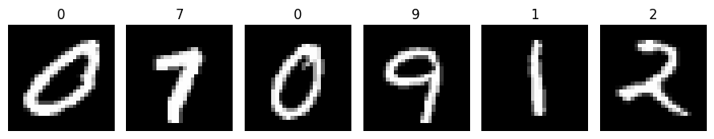
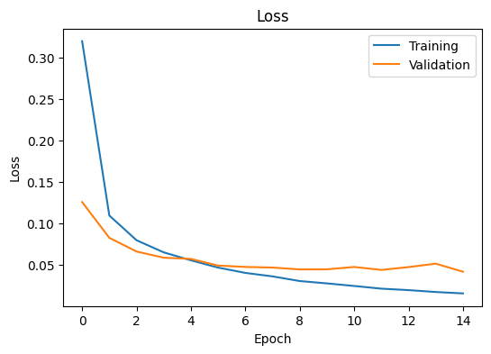
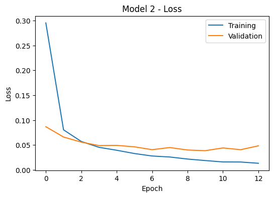
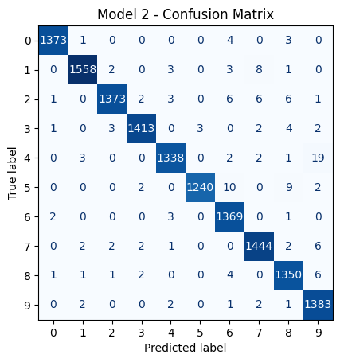
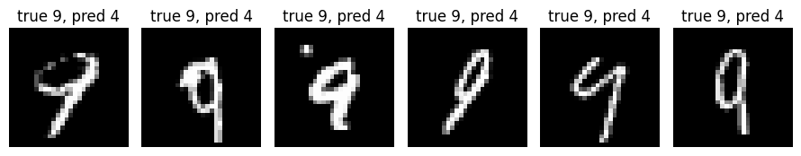

# Where does a CNN make its mistakes? Handwritten digit recognition on MNIST

Final project for the course *Machine Learning with Python* (LEAP Erasmus+), Option 1.

A convolutional neural network (CNN) that reads handwritten digits, followed by an analysis of **where** it goes wrong and whether **one change** to the architecture moves those mistakes.

**Central question:** *Where does the CNN make its mistakes, and does one change to the model move them?*

📓 **Notebook:** [`Final_Project_Option1_CNN_MNIST.ipynb`](Final_Project_Option1_CNN_MNIST.ipynb)  
📄 **Exported report:** [`Final_Project_Option1_CNN_MNIST.html`](Final_Project_Option1_CNN_MNIST.html) (download and open in a browser if the notebook does not render on GitHub)

---

## 1. Problem statement

Postal sorting centres and banks use software to read handwritten numbers, such as postcodes on envelopes and account numbers on forms. A wrong reading has a real cost: a misread postcode sends a letter to the wrong city, and a misread account number can misdirect a payment. So it is not enough for a model to be accurate on average; we also need to know **which digits it confuses**, so its mistakes can be anticipated rather than discovered in production.

The task is a 10-class image classification problem: given a 28×28 greyscale image, predict the digit (0–9).

## 2. Data set

- **Source:** MNIST, downloaded from OpenML (`mnist_784`) with `sklearn.datasets.fetch_openml`.
- **Size:** 70,000 images of handwritten digits, 28×28 pixels, one greyscale channel, labelled 0–9. The classes are roughly balanced.
- **Origin:** the digits were written by American Census Bureau employees and high-school students (relevant for the ethical discussion below).



## 3. Method

### Preprocessing
1. Each flat row of 784 pixel values was reshaped into a 28×28×1 image.
2. Pixel values were scaled from 0–255 to 0–1.
3. The data was split into **56,000 training** and **14,000 test** images (80/20, stratified by class, `random_state=42`).
4. During training, 10% of the training set (5,600 images) was held back for validation.

### Model 1: baseline CNN

| Layer | Details |
|---|---|
| Conv2D | 32 filters, 3×3, ReLU |
| MaxPooling2D | 2×2 |
| Dropout | 0.3 |
| Flatten | |
| Dense | 64 units, ReLU |
| Dense (output) | 10 units, softmax |

Total parameters: **347,146**

### Model 2: one controlled change (Option A, deeper network)

The same network with **one extra convolutional block** (Conv2D with 64 filters, 3×3, ReLU, followed by MaxPooling2D 2×2) added before the Flatten layer. Nothing else was changed.

I chose this change because the confusions found in Model 1 depend on fine shape details (for example, whether the loop at the top of a digit is closed), and a second convolutional layer can combine simple edges into more complex shapes such as loops and corners.

Interestingly, the deeper model has **fewer** parameters (**121,930**), because the second pooling layer shrinks the feature maps from 13×13×32 to 5×5×64 before the Dense layer.

### Training and evaluation
- Optimiser: Adam; loss: sparse categorical cross-entropy; metric: accuracy.
- Up to 15 epochs, batch size 128.
- EarlyStopping on validation loss (patience 3, best weights restored).
- Same random seed (42) and identical settings for both models, so the comparison is fair.
- Evaluation on the 14,000 unseen test images: accuracy, loss, and a **confusion matrix** for each model.

## 4. Results

### Overall performance

| | Model 1 (baseline) | Model 2 (deeper) |
|---|---|---|
| Test accuracy | 98.76% | 98.86% |
| Test loss | 0.0445 | 0.0376 |
| Total errors (out of 14,000) | 174 | 159 |
| Epochs trained | 15 (early stopping not triggered) | 13 (early stopping triggered) |
| Parameters | 347,146 | 121,930 |

### Learning curves

| Model 1 | Model 2 |
|---|---|
|  |  |

Both models learn quickly. In Model 1 the validation loss flattens after about 5 epochs while the training loss keeps falling, an early sign of overfitting. Model 2 learns faster, but its validation loss clearly rises at the end, so early stopping halted training and restored the best weights.

### Confusion matrices

| Model 1 | Model 2 |
|---|---|
|  |  |

### The main confusion pairs

| Error | Model 1 | Model 2 |
|---|---|---|
| true 4 → predicted 9 | 11 | 19 |
| true 9 → predicted 4 | 7 | 2 |
| **Pair 4 ↔ 9 (total)** | **18** | **21** |
| true 9 → predicted 7 | 5 | 2 |
| true 7 → predicted 9 | 4 | 6 |
| **Pair 7 ↔ 9 (total)** | **9** | **8** |

### Example mistakes



## 5. Interpretation

**Where are the mistakes?** In Model 1 the errors are concentrated on a few visually similar digits. The pair 4 ↔ 9 is by far the most common confusion (18 errors), followed by 7 ↔ 9 (9 errors). A 4 written with a closed top looks like the loop of a 9, and a 9 with an open or narrow loop can look like a 4 or a 7; the difference often depends on just a few pixels at the top of the digit.

**Did the change move them?** Yes, but it moved them rather than removing them:

- The 4 ↔ 9 confusion did not decrease (18 → 21). What changed was its **direction**: Model 1 made errors in both directions, while Model 2 almost always answers "9" for ambiguous images (4 → 9 rose from 11 to 19, 9 → 4 fell from 7 to 2). Column 9 of the confusion matrix collects 36 wrong predictions in Model 2, against 23 in Model 1.
- The 7 ↔ 9 pair barely changed (9 → 8).
- New errors appeared in Model 2, such as 5 → 6 (10), 5 → 8 (9) and 1 → 7 (8).

**Is the improvement meaningful?** The accuracy gain (+0.1 percentage points, 15 fewer errors) is too small to be called meaningful. I ran the whole notebook twice with the same seed, and because GPU training is not fully deterministic, the counts changed by a similar amount between runs. However, the shift of the 4 ↔ 9 errors towards "9" appeared in **both** runs, so it seems to be a real effect of the change. The lower test loss of Model 2 also suggests it is somewhat more confident on its correct answers.

**My prediction** (made before training Model 2) was only partly correct: I expected a small accuracy gain, which happened, and fewer 4 ↔ 9 confusions, which did not.

### Limitations
- Each model was evaluated from a single training run per notebook execution, so small differences cannot be separated from training randomness.
- MNIST is clean, centred and size-normalised; real envelopes and forms are messier.
- The model always outputs a digit, even for images it is unsure about.

## 6. Ethical considerations

MNIST was collected from American writers, so the model has mostly seen one regional style of handwriting. Writers from other countries may be read less reliably: many Europeans write a 1 with a long upstroke and cross their 7s, which could make the 1 → 7 confusion (already 8 errors in Model 2) more frequent. Children, elderly people, or people with motor impairments may also be under-represented.

The biggest risk in a real pipeline is a **confident misreading**: the softmax output always picks a digit, often with high probability, even when it is wrong. A safer system would route low-confidence readings to a human instead of accepting every prediction automatically.

## 7. Reflection

**What worked well.** I was surprised by how much a very small network can achieve: the baseline CNN, with a single convolutional layer, reached almost 99% accuracy after only a few minutes of training on a free Colab GPU. The confusion matrix turned out to be the most useful tool in the project. The overall accuracy told me very little about the model, but reading the matrix row by row showed me exactly which digits it struggles with. Writing a short script that lists the largest off-diagonal cells helped a lot, because it let me compare the two models cell by cell instead of searching the matrices by eye.

**What was difficult.** The hardest part was interpreting the results honestly rather than running the code. First, I had to decide how to count a "confusion pair": counting each direction separately or both directions together changes which pair comes second, so I had to choose one approach and state it clearly. Second, when I reran the whole notebook to check that it worked from top to bottom, the numbers changed slightly even though I used the same random seed, because training on a GPU is not fully deterministic. This meant I had to update my written answers, but it also taught me an important lesson: a difference of 10 or 15 errors out of 14,000 can appear just by chance, so I should not call one model better because its accuracy is a little higher. Finally, my prediction for the deeper network was partly wrong. I expected fewer 4 ↔ 9 confusions, but the errors only changed direction. At first this felt like a failed experiment, but I realised it was actually the most interesting finding of the project, because it shows that a change can move mistakes without removing them.

**What I would improve with more time.**
- Train each model with several random seeds (for example 5) and compare the average accuracy and error counts, so that real effects can be separated from noise. My two runs suggest the shift towards "9" is real, but two runs are not enough to be sure.
- Test the other change (Dropout 0.5) on its own, to see whether stronger regularisation moves the mistakes in a different way.
- Use data augmentation, such as small rotations, shifts and changes in stroke thickness, to make the model more robust to handwriting styles that are rare in MNIST.
- Add a confidence threshold, so that predictions with low probability are flagged for human review, and measure how many of the 4 ↔ 9 errors such a rule would catch.
- Test the model on digits written by people outside the United States (for example, my own handwriting or that of classmates), to check the concern raised in the ethical considerations.

## 8. How to run

1. Open the notebook in [Google Colab](https://colab.research.google.com) (File → Upload notebook).
2. Optional but recommended: Runtime → Change runtime type → T4 GPU.
3. Run all cells from top to bottom. MNIST is downloaded automatically, so an internet connection is needed the first time.

Requirements: Python 3, NumPy, Matplotlib, scikit-learn, Keras (all pre-installed in Colab).

## Repository structure

```
├── README.md                                 this file
├── Final_Project_Option1_CNN_MNIST.ipynb     completed notebook, all outputs visible
├── Final_Project_Option1_CNN_MNIST.html      exported report
└── figures/
    ├── sample_digits.png
    ├── learning_curves_model1.png
    ├── learning_curves_model2.png
    ├── confusion_matrix_model1.png
    ├── confusion_matrix_model2.png
    └── misclassified_9_as_4.png
```
